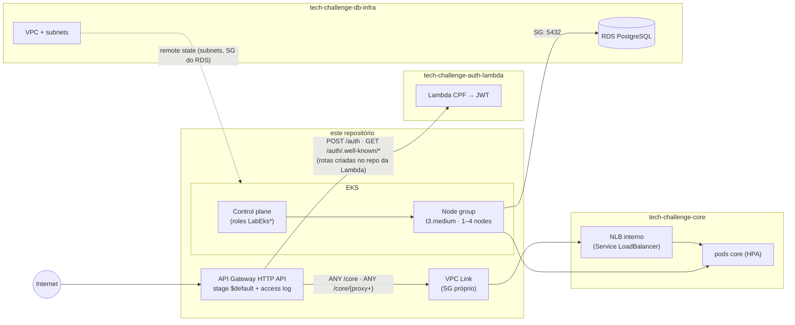

# tech-challenge-k8s-infra

Terraform do cluster Kubernetes e da porta de entrada HTTP da oficina.

O que sobe aqui:

- Amazon EKS (control plane + node group) + add-on `metrics-server` (base do HPA do core)
- Security groups (incluindo liberação dos nodes para o Postgres na 5432)
- API Gateway HTTP API + VPC Link para `/core` (NLB interno do Service no EKS)
- `/auth` fica no Terraform do auth-lambda (não preencha `auth_lambda_invoke_arn` aqui)

A VPC e o RDS vêm do [tech-challenge-db-infra](https://github.com/fiap-pos-2026/tech-challenge-db-infra) via remote state. A app está em [tech-challenge-core](https://github.com/fiap-pos-2026/tech-challenge-core); a auth serverless em [tech-challenge-auth-lambda](https://github.com/fiap-pos-2026/tech-challenge-auth-lambda).



A rota `/core` é criada por **discovery**: o Terraform procura o NLB pela tag
`kubernetes.io/service-name=tech-challenge/core`, que só existe depois do primeiro deploy do core.

## Stack

| Item | Valor |
|---|---|
| Nuvem | AWS (`us-east-1` no lab da FIAP) |
| Cluster | EKS |
| IAM no lab | roles prontas `*LabEksClusterRole*` / `*LabEksNodeRole*` (não criamos role no Terraform) |
| Entrada | API Gateway HTTP API |
| IaC | Terraform ≥ 1.6 |

No lab, `iam:CreateRole` é bloqueado. O código procura as roles EKS que a academia já deixa na conta; se precisar, você fixa o nome exato no tfvars.

## Outputs

Repositório público: **não** versionamos endpoint do EKS, URL do Gateway, IDs de security group nem nomes longos de role.

```bash
terraform output
```

Para o kubectl (com o lab ativo):

```bash
aws eks update-kubeconfig --name "$(terraform output -raw cluster_name)" --region us-east-1
kubectl get nodes
```

## Como rodar local

1. `db-infra` já aplicado e state acessível.
2. Preencha bucket/tabela e aponte o remote state do banco:

```bash
cp terraform.tfvars.example terraform.tfvars
cp backend.hcl.example backend.hcl
terraform init -backend-config=backend.hcl
terraform plan -var-file=terraform.tfvars
terraform apply -var-file=terraform.tfvars
```

Não commite `terraform.tfvars`, `backend.hcl` nem state.

## Rota `/core` (NLB + VPC Link)

1. Apply deste repo (sobe EKS, HTTP API e VPC Link; a rota `/core` só aparece se o NLB já existir).
2. Deploy do `tech-challenge-core` no overlay `homolog` (Service `LoadBalancer` → NLB interno).
3. **Re-apply** deste repo (`workflow_dispatch` ou push em `main`) para o discovery achar o NLB e criar `ANY /core` + `ANY /core/{proxy+}`.

Override opcional: `TF_VAR_core_nlb_listener_arn` com o ARN do listener TCP.

## CI

PR: fmt, validate, plan.  
`main` (ou `workflow_dispatch`): apply em homolog (Plan **não** roda no dispatch — evita disputa de lock com o Apply).

Secrets: access key, secret, session token, bucket e tabela de lock.

## Custo

EKS control plane e os nodes pesam bastante, somados ao NAT do `db-infra`. Fora de uso: destrua a Lambda de auth e o NLB do core (ou o Service), depois **este** stack, e por último o `db-infra` — senão ENIs prendem as subnets privadas. Confira o crédito no portal do lab.
